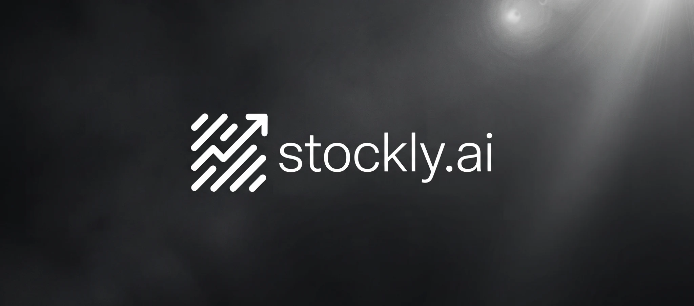
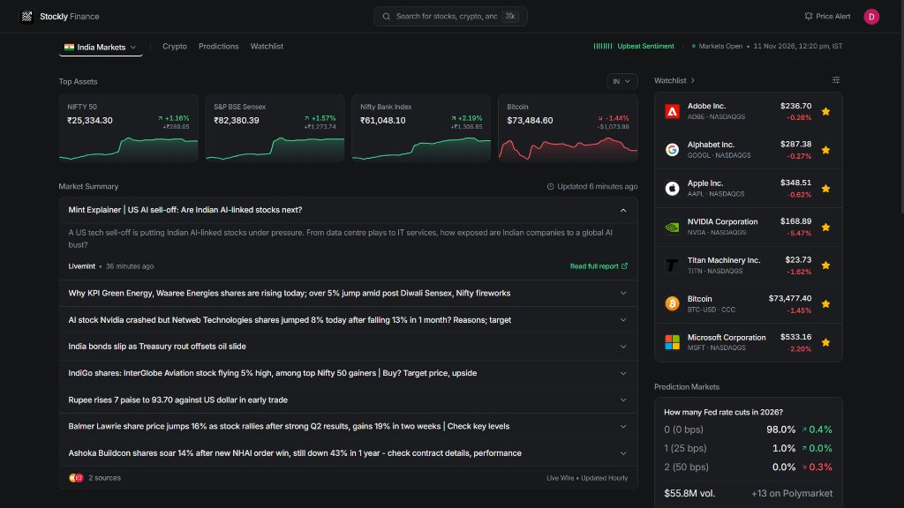
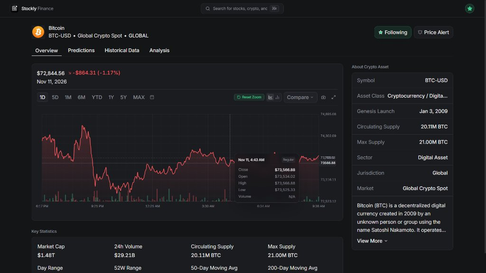
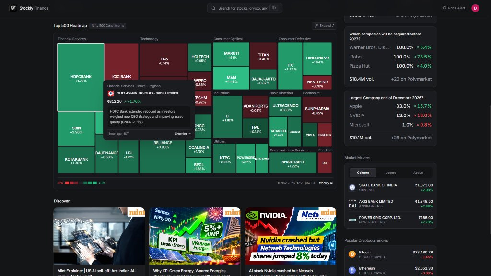
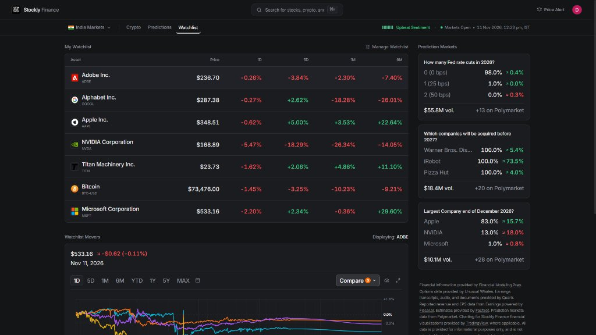
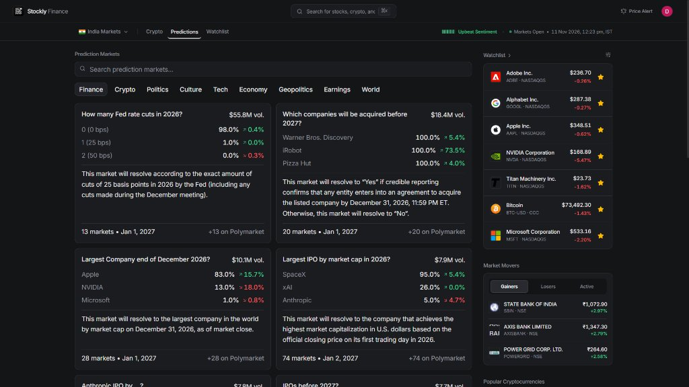
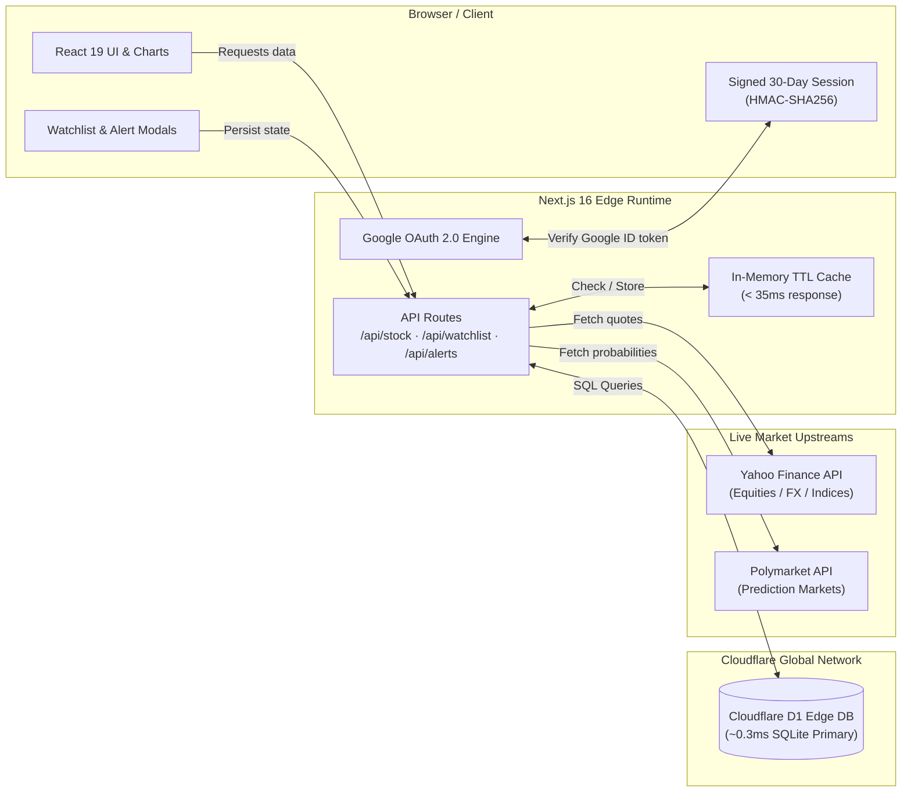

<div align="center">
  <a href="https://stocklyai.vercel.app">
    
  </a>
</div>

<h1 align="center">Stockly.ai</h1>

<p align="center">
  <strong>Real-Time Financial Intelligence & Market Terminal at the Edge.</strong>
</p>

<p align="center">
  Track global equities, Indian & US indices, cryptocurrencies, and prediction markets — powered by Next.js 16 and Cloudflare D1 with sub-millisecond edge persistence.
</p>

<p align="center">
  <a href="https://stocklyai.vercel.app/"><strong>Live Terminal</strong></a> ·
  <a href="#-terminal-interface">Interface</a> ·
  <a href="#-how-it-works">Architecture</a> ·
  <a href="#-core-features">Features</a> ·
  <a href="#-quick-start">Quick Start</a> ·
  <a href="#-database-architecture">Database</a> ·
  <a href="#-license">License</a>
</p>

<p align="center">
  <a href="https://github.com/anshk1234/stockly.ai/actions/workflows/ci.yml"></a>
  <a href="https://stocklyai.vercel.app/"></a>
  <a href="https://developers.cloudflare.com/d1/"></a>
  <a href="https://nextjs.org/"></a>
  <a href="https://react.dev/"></a>
  <a href="https://tailwindcss.com/"></a>
  <a href="https://www.bestpractices.dev/projects/16600"></a>
  <a href="LICENSE"></a>
</p>

<p align="center">
  <strong>Supported By:</strong>
</p>

<p align="center">
  <a href="https://www.mintlify.com/oss-program">
    
  </a>
</p>

---

## 💡 Why Stockly.ai?

Financial tracking today is fractured between two extremes:
1. **Bloated legacy terminals**: Prohibitively expensive ($2,000+/mo), clunky desktop interfaces, and complex learning curves.
2. **Freemium web portals**: Filled with intrusive ads, paid paywalls for basic technical stats, delayed quotes, and slow multi-second page loads.

**Stockly.ai** provides an open-source, ultra-fast alternative. It combines modern UI ergonomics with a serverless edge architecture:

- **Sub-Millisecond Edge Database**: Watchlists, price alerts, and user profiles are stored in **Cloudflare D1** (distributed SQLite running directly at Cloudflare edge nodes with `~0.3ms` query execution).
- **Sub-35ms In-Memory Caching**: High-throughput TTL caching layer shields downstream market APIs and guarantees near-instant responses.
- **GPU-Accelerated 360-Point Morphing Charts**: Interactive SVG line curves standardizing 360 uniform control points across all periods (1D, 5D, 1M, 6M, 1Y, 5Y) for silky smooth CSS morph transitions.
- **100% Free & Open-Source**: Free forever, no paywalls, no tracking scripts, and fully transparent under the Apache-2.0 license.

---

## Terminal Interface

<table width="100%">
  <tr align="center">
    <th width="50%">Live Market Dashboard</th>
    <th width="50%">Interactive Pro Charting & Key Statistics</th>
  </tr>
  <tr>
    <td><a href="https://stocklyai.vercel.app"></a></td>
    <td><a href="https://stocklyai.vercel.app"></a></td>
  </tr>
  <tr align="center">
    <th>Top 500 Interactive Sector Heatmap</th>
    <th> Multi-Asset Watchlist</th>
  </tr>
  <tr>
    <td><a href="https://stocklyai.vercel.app"></a></td>
    <td><a href="https://stocklyai.vercel.app"></a></td>
  </tr>
  <tr align="center">
    <th colspan="2">Prediction Markets Terminal (Polymarket Integration)</th>
  </tr>
  <tr>
    <td colspan="2"><a href="https://stocklyai.vercel.app"></a></td>
  </tr>
</table>

---

## ⚡ How It Works

Stockly.ai operates on an edge-first architecture. The client talks to Next.js 16 App Router server endpoints, which query a high-speed TTL cache, stream live market quotes, and synchronize state with Cloudflare D1.



---

## ✨ Core Features

### 1. Interactive Pro Financial Charting
- **Fluid Timeframe Morphing**: Standardized 360-control-point SVG cubic Bézier curves enable smooth GPU-accelerated CSS path transitions across all timeframes (`1D`, `5D`, `1M`, `6M`, `1Y`, `5Y`, `ALL`).
- **Live 1-Minute Intraday Bumps**: Real-time intraday point updates accurate down to the minute.
- **Dynamic Baseline Indicators**: Real-time relative baseline comparison showing gain/loss color dynamics (emerald green vs. crimson red) based on previous close.
- **Precision Hover Card**: Non-obstructive translucent glassmorphic hover card reporting timestamp, exact price, and period delta.
- **Mouse & Touch Navigation**: Pointer-anchored mouse wheel zoom in/out and drag-to-pan historical navigation.

### 2. Multi-Market Global Coverage
- **US Markets**: S&P 500, NASDAQ Composite, Dow Jones Industrial Average, Russell 2000, and all US equities.
- **Indian Markets**: NSE NIFTY 50, BSE Sensex, Nifty Bank, and major Indian NSE/BSE listed assets.
- **Cryptocurrencies**: Real-time 24h prices, volume, and sparkline charts for Bitcoin, Ethereum, Solana, and top altcoins.
- **Prediction Markets**: Real-time probability curves, outcome odds, and volume from Polymarket.
- **S&P 500 & Sector Heatmap**: Visual treemap of sector gainers, losers, and market capitalizations.
- **Auto-Geolocation**: Automated IP-based market preference detection (`/api/geo`) to adapt default tickers to the visitor's local region.

### 3. Cloudflare D1 Serverless Persistence
- **Edge SQLite Queries**: Watchlist and price alert modifications execute in `~0.3ms` without spin-up delays or cold starts.
- **Zero-Latency State**: Direct REST edge client querying Cloudflare D1 primary nodes over secure Cloudflare API tokens.
- **Relational Integrity**: Foreign key constraints and indexed queries (`idx_watchlists_user`, `idx_price_alerts_user`).

### 4. Google OAuth 2.0 & Session Security
- **Secure 30-Day Sessions**: User authentication backed by signed `stockly_session` HTTP cookies.
- **Cryptographic Verification**: HMAC-SHA256 signature verification with constant-time buffer comparison to prevent timing attacks.
- **Zero Third-Party Vendor Lock-in**: Fully native OAuth 2.0 handshake with Google Cloud Console and CSRF state parameter validation.
- **Profile Management**: Profile drawer displaying user name, email, Google avatar, and one-click session invalidation.

### 5. Perplexity-Style Watchlist & Alerts
- **Star Toggle Anywhere**: Instant `★` / `☆` toggling on any asset across all views with optimistic UI feedback.
- **Manage Watchlist Modal**: Dedicated management modal with live asset search autocomplete, one-click add, and instant removal.
- **Configurable Price Alerts**: Target price alerts with threshold conditions (`Above`, `Below`, or `Movement %`) and multi-channel delivery configuration (in-app, push, email).

### 6. Social Sharing & Keyboard Workflows
- **Branded Screenshot Modal**: One-click generation of high-resolution chart snapshots formatted for social sharing on X, LinkedIn, or Telegram.
- **Instant Search Popover (`⌘K` / `Ctrl+K`)**: Blazing-fast keyboard search with recent search persistence and trending tickers.

---

## 📊 Performance Benchmarks

Measured on production build running on Vercel Edge Network connected to Cloudflare D1 APAC primary:

| Metric | Result | Architecture / Technique |
|:---|:---|:---|
| **Cloudflare D1 Query Duration** | **0.31 ms** | Serverless Edge SQLite (`api.cloudflare.com/client/v4/.../d1`) |
| **In-Memory Cache Latency** | **< 35 ms** | Keyed TTL Cache with stale-while-revalidate protection |
| **Chart Timeframe Morphing** | **60 FPS** | 360-point standardized SVG path with GPU-accelerated CSS |
| **Google Session Verification** | **< 1 ms** | Native Node.js `crypto.createHmac` with constant-time equality |
| **Production Build Status** | **0 Errors** | Next.js 16 App Router + Turbopack strict TypeScript compilation |

---

## 🛠️ Tech Stack

| Layer | Technology | Details |
|:---|:---|:---|
| **Framework** | [Next.js 16](https://nextjs.org/) | App Router, Server Components, Route Handlers, Turbopack |
| **UI Library** | [React 19](https://react.dev/) | React Server Components, Actions, optimistic state hooks |
| **Language** | [TypeScript 5](https://www.typescriptlang.org/) | Strict type checking across API responses and DB models |
| **Database** | [Cloudflare D1](https://developers.cloudflare.com/d1/) | Distributed serverless SQLite at the edge |
| **Styling** | [Tailwind CSS v4](https://tailwindcss.com/) | Modern CSS variable theme, glassmorphic utility classes |
| **Icons** | [Lucide React](https://lucide.dev/) | Clean, consistent SVG icon set |
| **Financial Engine** | `yahoo-finance2` | High-fidelity real-time quotes, technical candles, company profiles |
| **Prediction Data** | Polymarket API | Decentralized prediction market odds & volume metrics |
| **Authentication** | Google OAuth 2.0 | Native CSRF-protected OAuth with HMAC-SHA256 session cookies |
| **Deployment** | [Vercel](https://vercel.com/) | Edge Network, automated continuous integration |

---

## 📁 Project Structure

```
stockly.ai/
├── public/                  # Static assets, SVG icons, and logos
│   ├── icon.svg             # Official Stockly.ai vector mark
│   └── favicon.svg          # High-resolution favicon
├── src/
│   ├── app/                 # Next.js 16 App Router
│   │   ├── api/             # Edge API route handlers
│   │   │   ├── alerts/      # Price alerts management (GET, POST, DELETE)
│   │   │   ├── assets/      # Multi-asset batch quote streamer
│   │   │   ├── auth/        # Google OAuth flow & session validation
│   │   │   ├── crypto/      # Cryptocurrency prices & 24h volume
│   │   │   ├── discover/    # Market discovery lists & trending tickers
│   │   │   ├── geo/         # Geolocation-based market detection
│   │   │   ├── heatmap/     # S&P 500 & sector performance treemap
│   │   │   ├── movers/      # Top gainers, losers, and most active
│   │   │   ├── news/        # Curated financial news feed
│   │   │   ├── predictions/ # Polymarket live event odds
│   │   │   ├── search/      # Instant ticker & company search
│   │   │   ├── status/      # Market hours & exchange status
│   │   │   ├── stock/       # In-depth ticker candles, profile, & financials
│   │   │   └── watchlist/   # User watchlist persistence (GET, POST, DELETE)
│   │   ├── stocks/[symbol]/ # Dynamic individual stock page
│   │   ├── layout.tsx       # Root layout & providers
│   │   └── page.tsx         # Main terminal dashboard
│   ├── components/          # React components
│   │   ├── crypto/          # Crypto market widgets & cards
│   │   ├── modals/          # Auth, Watchlist Management, Price Alert, Share Modals
│   │   ├── stock/           # InteractiveStockChart, KeyStatsGrid, CompanyProfileWidget
│   │   ├── ui/              # Glassmorphic primitives, tooltips, dialogs
│   │   ├── views/           # WatchlistView, CryptoView, PredictionsView
│   │   ├── Header.tsx       # Top navigation, search bar, profile drawer
│   │   └── WatchlistWidget.tsx # Live watchlist sidebar with optimistic star toggles
│   ├── context/             # Global AppContext (auth, saved symbols, active tab)
│   └── lib/                 # Core server utilities & database clients
│       ├── auth.ts          # HMAC-SHA256 session token creation & verification
│       ├── cache.ts         # In-memory TTL cache with expiration management
│       ├── db.ts            # Cloudflare D1 REST client for edge SQL queries
│       ├── user.ts          # D1 queries for users, watchlists, & alerts
│       ├── yahoo.ts         # Market quote & candle formatting engine
│       ├── polymarket.ts    # Prediction market client
│       └── types.ts         # TypeScript interfaces & domain models
├── schema.sql               # Cloudflare D1 database schema definitions
├── .env.example             # Template for required environment variables
├── package.json             # Dependencies and scripts
└── tsconfig.json            # TypeScript configuration
```

---

## 🗄️ Database Architecture

The persistence layer runs on **Cloudflare D1** (serverless edge SQLite) with zero spin-up cold starts and sub-millisecond query execution. Schema definitions are tracked in [`schema.sql`](schema.sql):

| Table | Purpose | Indexing & Constraints |
|:---|:---|:---|
| `users` | Authenticated Google OAuth profiles & metadata | Primary Key: `id` (Google `sub`), Unique `email` |
| `watchlists` | Edge-persisted user symbols and asset types | Composite Unique: `(user_id, symbol)`, Index: `idx_watchlists_user` |
| `price_alerts` | Real-time threshold targets & notify channels | Index: `idx_price_alerts_user`, `idx_price_alerts_status` |
| `portfolios` | Multi-asset portfolio holdings & allocations | Foreign Key: `user_id` CASCADE |

<details>
<summary><b>View Cloudflare D1 SQL Schema</b></summary>

```sql
-- 1. Users Table (Google OAuth profile & 30-day session)
CREATE TABLE IF NOT EXISTS users (
  id TEXT PRIMARY KEY,               -- Google 'sub' ID
  email TEXT UNIQUE NOT NULL,
  name TEXT NOT NULL,
  avatar_url TEXT,
  created_at INTEGER NOT NULL,       -- Epoch milliseconds
  updated_at INTEGER NOT NULL
);

-- 2. User Watchlists Table (Edge-persisted symbols)
CREATE TABLE IF NOT EXISTS watchlists (
  id TEXT PRIMARY KEY,
  user_id TEXT NOT NULL,
  symbol TEXT NOT NULL,              -- e.g. 'NVDA', 'AAPL', '^NSEBANK'
  name TEXT NOT NULL,
  asset_type TEXT DEFAULT 'STOCK',
  created_at INTEGER NOT NULL,
  FOREIGN KEY (user_id) REFERENCES users(id) ON DELETE CASCADE,
  UNIQUE(user_id, symbol)
);

-- 3. Price Alerts Table (Perplexity Finance Style)
CREATE TABLE IF NOT EXISTS price_alerts (
  id TEXT PRIMARY KEY,
  user_id TEXT NOT NULL,
  symbol TEXT NOT NULL,
  criteria TEXT NOT NULL,            -- 'TARGET_PRICE' | 'MOVEMENT_AMOUNT'
  target_price REAL,
  movement_pct REAL,
  channels TEXT NOT NULL,            -- JSON array: '["in_app", "email"]'
  status TEXT NOT NULL DEFAULT 'ACTIVE',
  created_at INTEGER NOT NULL,
  FOREIGN KEY (user_id) REFERENCES users(id) ON DELETE CASCADE
);
```
</details>

---

## 🚀 Quick Start

### Prerequisites
- [Node.js](https://nodejs.org/) version 20.0 or higher
- `npm` or `pnpm`
- (Optional) Free [Cloudflare account](https://dash.cloudflare.com/) for D1 edge persistence
- (Optional) [Google Cloud Console project](https://console.cloud.google.com/) for Google Sign-In

### 1. Clone the Repository
```bash
git clone https://github.com/anshk1234/stockly.ai.git
cd stockly.ai
```

### 2. Install Dependencies
```bash
npm install
```

### 3. Configure Environment Variables
Copy `.env.example` to `.env.local`:
```bash
cp .env.example .env.local
```

Populate the required keys in `.env.local`:
```env
# Application URL
NEXT_PUBLIC_APP_URL=http://localhost:3000

# Authentication & Session Security (HMAC-SHA256)
AUTH_SECRET=your_32_character_random_session_secret_here

# Google OAuth 2.0 Credentials (https://console.cloud.google.com/apis/credentials)
GOOGLE_CLIENT_ID=your_google_client_id.apps.googleusercontent.com
GOOGLE_CLIENT_SECRET=your_google_client_secret

# Cloudflare D1 Serverless Edge Database (https://dash.cloudflare.com/)
CLOUDFLARE_ACCOUNT_ID=your_cloudflare_account_id
CLOUDFLARE_DATABASE_ID=your_d1_database_uuid
CLOUDFLARE_D1_TOKEN=your_cloudflare_d1_api_token
```

> **Note**: For local development without Cloudflare credentials, the app gracefully falls back to memory storage for instant testing.

### 4. Run Development Server
```bash
npm run dev
```

Open [http://localhost:3000](http://localhost:3000) in your browser to view the terminal.

---

## 📜 Available Scripts

| Command | Description |
|:---|:---|
| `npm run dev` | Starts the Next.js development server with Turbopack |
| `npm run build` | Builds the optimized production application |
| `npm run start` | Starts the production server |
| `npm run lint` | Runs ESLint 9 to validate code quality |

---

## 🤝 Contributing

Contributions are welcomed! Whether it's adding a new technical indicator, expanding regional exchange coverage, or improving performance:

1. **Fork** the repository.
2. **Create a Feature Branch** (`git checkout -b feature/amazing-feature`).
3. **Commit your Changes** (`git commit -m 'feat: add amazing feature'`).
4. **Push to the Branch** (`git push origin feature/amazing-feature`).
5. **Open a Pull Request**.

Please ensure your changes pass the production build (`npm run build`) and linting (`npm run lint`) before submitting.

---

## 👤 Maintainer

<div align="center">
  <table width="60%">
    <tr align="center">
      <td valign="top">
        <a href="https://github.com/anshk1234" target="_blank"></a>
        <br/>
        <strong>Ansh Kunwar</strong>
        <p>
          <a href="https://github.com/anshk1234" target="_blank"></a>&nbsp;&nbsp;<a href="mailto:anshkunwar3009@gmail.com"></a>
        </p>
      </td>
    </tr>
  </table>
</div>

---

## 📄 License

This project is open-source software licensed under the **[Apache License 2.0](LICENSE)**.

```
Copyright 2026 Ansh Kunwar

Licensed under the Apache License, Version 2.0 (the "License");
you may not use this file except in compliance with the License.
You may obtain a copy of the License at

    http://www.apache.org/licenses/LICENSE-2.0
```

<div align="center">
  <p>Crafted with precision for retail investors and open-source developers worldwide.</p>
</div>
